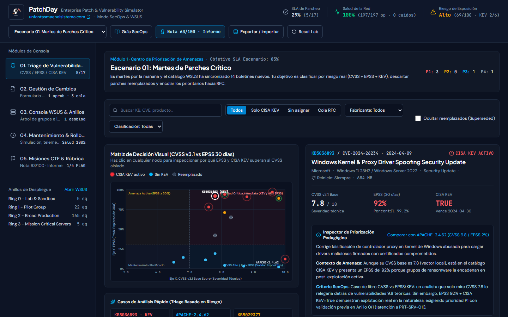
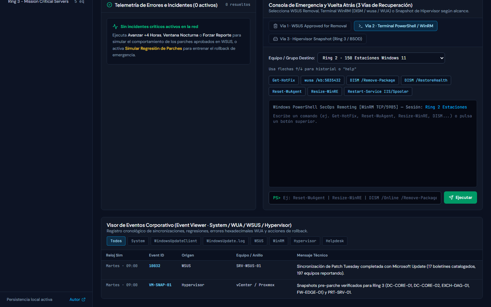
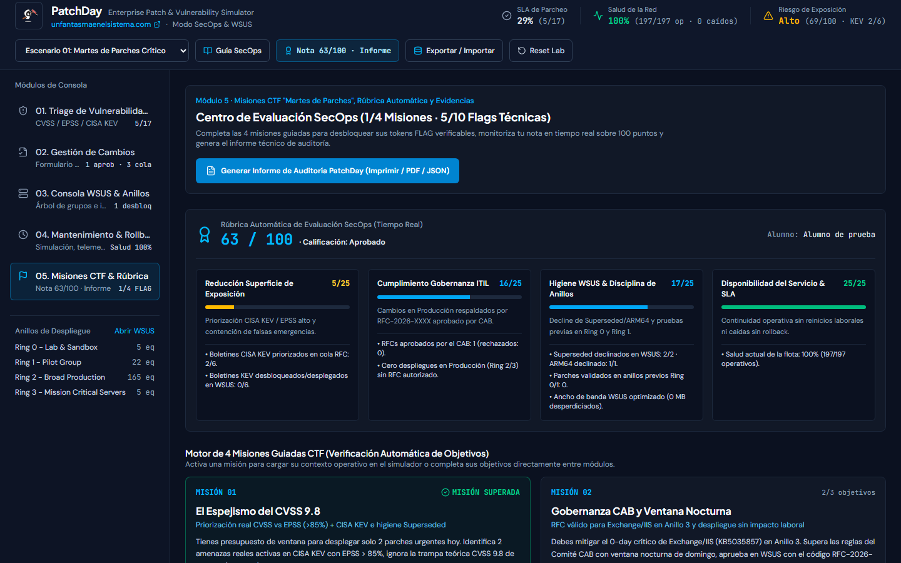
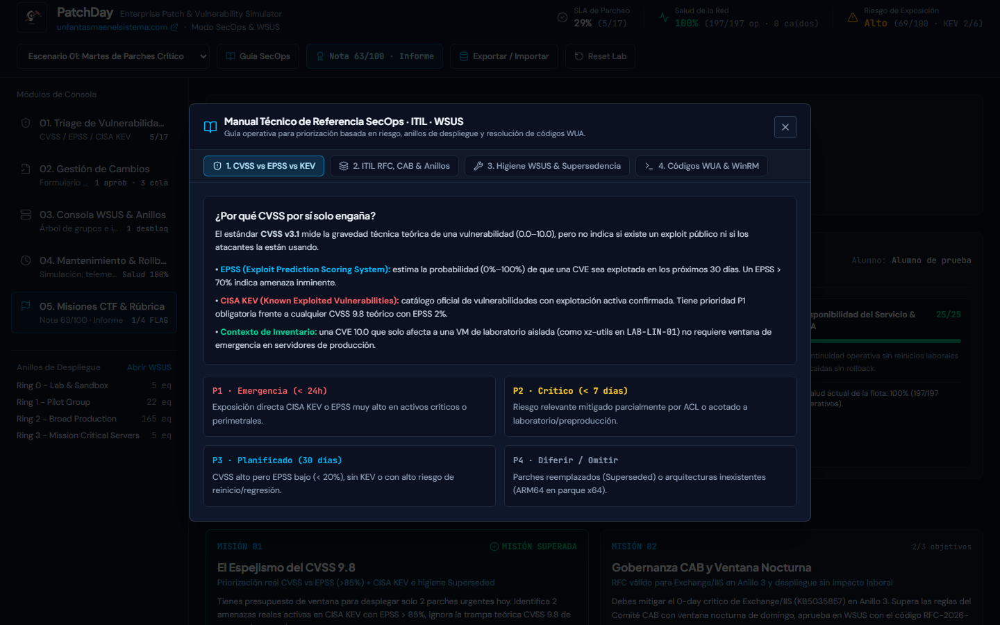
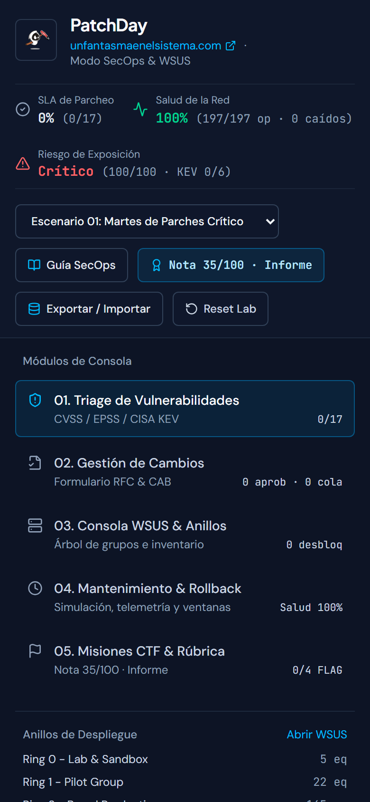

<div align="center">
  <a href="https://www.unfantasmaenelsistema.com/">
    
  </a>

# PatchDay — Simulador Empresarial de Gestión de Parches, WSUS y SecOps

[](https://unfantasmaenelsistema.github.io/PatchDay/)
[](#stack-tecnológico)
[](./LICENSE)

**[▶ Abrir el simulador](https://unfantasmaenelsistema.github.io/PatchDay/)**
</div>

**PatchDay** es un laboratorio educativo e interactivo **100% client-side** diseñado para entrenar a analistas SecOps, administradores de sistemas (SysAdmin / ASIR) y equipos de respuesta ante incidentes en el ciclo de vida completo del parcheo corporativo: priorización de vulnerabilidades basada en riesgo real (**CVSS v3.1 + EPSS + CISA KEV**), gobernanza de cambios **ITIL (RFC / CAB)**, despliegue escalonado por anillos en consola **Microsoft WSUS (`SRV-WSUS-01`)**, diagnóstico de fallos del agente Windows Update y ejecución táctica de **rollback** en producción.

Proyecto creado para [Un Fantasma en el Sistema](https://www.unfantasmaenelsistema.com/).

## Tabla de Contenidos

- [Características Principales](#características-principales)
- [Recorrido Visual por los Módulos](#recorrido-visual-por-los-módulos)
- [Stack Tecnológico](#stack-tecnológico)
- [Instalación y Uso Local](#instalación-y-uso-local)
- [Despliegue Automático en GitHub Pages](#despliegue-automático-en-github-pages)
- [Estructura del Proyecto](#estructura-del-proyecto)
- [Novedades de la versión 2](#novedades-de-la-versión-2)
- [Licencia](#licencia)

---

## Características Principales

- **100% Estático y Portable (GitHub Pages Ready):** Funciona íntegramente en el navegador sin servidor ni base de datos externa. Toda la sesión se persiste automáticamente en `localStorage`, con exportación/importación en **JSON / Base64** y botón de **Reset Lab**. Al importar (o al leer `localStorage`) cada campo se valida y los RFC se vuelven a dictaminar con las reglas del CAB, así que un snapshot editado a mano no puede aprobar cambios que el CAB rechazaría ni dejar la aplicación en blanco.
- **Catálogo Realista de 17 Boletines e Inventario de 197 Equipos:** Incluye actualizaciones acumulativas de Windows 11 / Server 2022, Exchange Server, SQL Server, Fortinet FortiOS, Chrome, Apache HTTP Server, OpenSSH, xz-utils, 7-Zip y paquetes ARM64/Superseded con cadenas reales de reemplazo.
- **Arquitectura de 4 Anillos de Despliegue:**
  - **Ring 0 — Lab & Sandbox (5 equipos):** Abierto 24/7 para validación inicial y pruebas de *soak*.
  - **Ring 1 — Pilot Group (22 equipos):** Usuarios avanzados y servidores de preproducción (Martes y Jueves `14:00–16:00`).
  - **Ring 2 — Broad Production (165 equipos):** Flota corporativa general (Sábados `02:00–06:00`).
  - **Ring 3 — Mission Critical Servers (5 servidores):** Domain Controllers, clúster SQL Server y Exchange DAG (Domingos `01:00–04:00`, requiere snapshot previo).
- **Motor CAB Automático & Reglas ITIL:** Bloquea aprobaciones en Producción (Anillos 2 y 3) dentro de WSUS hasta obtener un sello válido `RFC-2026-XXXX` aprobado por el Comité de Cambios.
- **Telemetría de Errores Reales & Consola PowerShell/WinRM:** Diagnóstico sobre `WindowsUpdate.log`, Event Viewer y consola interactiva con comandos reales (`wusa /uninstall`, `DISM /RestoreHealth`, `Reset-WuAgent`, `UsoClient StartScan`, `netsh winhttp`).
- **Evaluación Automática (0–100) + Misiones CTF + Informe de Auditoría:** 4 misiones guiadas con tokens `FLAG{...}`, 10 flags técnicas y generador de informe exportable en **PDF / Impresión, JSON y HTML Offline** con una huella determinista del progreso. Todo se calcula en el navegador: son evidencias educativas para la clase, no una prueba frente a quien manipule el código.

---

## Recorrido Visual por los Módulos

> Capturas de la versión 2 tomadas sobre la compilación de producción, con un laboratorio a medio resolver (triage, un RFC aprobado por el CAB y limpieza WSUS).

### 1. Centro de Priorización de Amenazas (Triage CVSS / EPSS / CISA KEV)
Matriz visual interactiva que confronta severidad técnica (`CVSS v3.1`) frente a probabilidad real de explotación (`EPSS 30 días`) y presencia en el catálogo `CISA KEV`, desmontando trampas clásicas como priorizar un CVSS 9.8 teórico (`EPSS 2%`) por encima de un CVSS 7.8 explotado activamente (`EPSS 92% · KEV`).



---

### 2. Gestión de Cambios ITIL (Formulario RFC & Motor CAB)
Flujo de petición de cambio (`Estándar`, `Normal` o `Emergencia / Expedited`) con validación en tiempo real de pruebas previas en Ring 0/1, coherencia de reinicio, plan técnico de vuelta atrás y conflictos con ventanas de mantenimiento o *Blackout Periods* (cierre fiscal / auditoría).


---

### 3. Consola WSUS (`SRV-WSUS-01`) & Despliegue por Anillos
Réplica funcional de la consola clásica MMC de Microsoft WSUS: árbol de nodos (`Updates` y `Computers` por anillo), filtros `Approval` / `Status`, iconos visuales de supersedencia, declinación de parches obsoletos o ARM64, aprobación granular con `Deadline` y bloqueo automático si falta autorización CAB para Ring 2/3.


---

### 4. Motor de Simulación Temporal, Telemetría de Errores y Rollback en 3 Vías
Avanza el reloj simulado (`+4 Horas`, `Ventana Nocturna`, `wuauclt /reportnow`) o dispara un simulacro de regresión real para detectar bucles BSOD (`KB5036893` sin 24h de soak en Ring 0/1), caídas de Kerberos/IIS (`KB5034763` / `KB5035857`) y errores WUA (`0x800f0922`, `0x8024402c`, `0x800f081f`, `0x80070005`), remediando por:
1. **Vía 1:** `Approved for Removal` en WSUS.
2. **Vía 2:** Terminal PowerShell / WinRM (`DISM`, `wusa /uninstall`, `Reset-WuAgent`).
3. **Vía 3:** Restauración de Snapshot en Hipervisor (VMware vCenter / Proxmox).



---

### 5. Misiones CTF, Rúbrica Automática SecOps y Manual Técnico
Evaluación continua sobre **100 puntos** dividida en 4 KPIs de 25 puntos cada uno (*Reducción Superficie de Exposición*, *Cumplimiento Gobernanza ITIL*, *Higiene WSUS & Disciplina de Anillos* y *Disponibilidad del Servicio & SLA*), junto a 4 misiones guiadas CTF:

| Misión | Reto Operativo | Enfoque Técnico |
| :--- | :--- | :--- |
| **Misión 01** | *El Espejismo del CVSS 9.8* | Priorizar CISA KEV + EPSS > 85%, descartar CVSS 9.8 teórico y declinar `Superseded` |
| **Misión 02** | *Gobernanza CAB y Ventana Nocturna* | RFC aprobado por el CAB para Exchange/IIS en Ring 3 con la ventana nocturna del domingo, sin interrumpir horario laboral |
| **Misión 03** | *Pánico en el Anillo Piloto (Rollback Táctico)* | Frenar regresión en `DEV-SQL-01` (Ring 1) antes de Ring 2 mediante `wusa` / Removal |
| **Misión 04** | *Caos en el Agente Windows Update* | Diagnosticar `0x8024402c` y `0x800f081f` en `WindowsUpdate.log` y reparar 3 servidores Ring 3 |



---

### 6. Informe Técnico de Auditoría y Manual de Referencia SecOps
Permite identificar al alumno/operador y exportar evidencias verificables en **PDF**, **JSON** o **HTML autocontenido**, además de consultar en cualquier momento la **Guía SecOps** integrada con tablas de códigos WUA, reglas CAB y comandos WinRM.




### 7. Versión móvil



---

## Stack Tecnológico

- **Frontend:** React 19 + TypeScript
- **Estilos e Iconografía:** Tailwind CSS v4 + Lucide React
- **Build & Tooling:** Vite 8 (`base: './'` para compatibilidad directa con subrutas de GitHub Pages)
- **Persistencia:** `localStorage` del navegador + Exportación/Importación JSON/Base64

---

## Instalación y Uso Local

Requisitos: **[Bun](https://bun.sh/)** (el proyecto usa `bun.lock`).

```bash
git clone https://github.com/unfantasmaenelsistema/PatchDay.git
cd PatchDay
bun install
bun run dev        # http://localhost:3000
bun run lint       # comprobación de tipos con TypeScript
bun run build      # genera ./dist para publicar
```

---

## Despliegue Automático en GitHub Pages

El flujo [`.github/workflows/deploy.yml`](./.github/workflows/deploy.yml) se ejecuta en cada `push` a `main`: instala con Bun (`bun install --frozen-lockfile`), compila `./dist` y lo publica en https://unfantasmaenelsistema.github.io/PatchDay/ (en **Settings → Pages**, la fuente es **GitHub Actions**).

---

## Estructura del Proyecto

```text
.
├── .github/workflows/deploy.yml   # Pipeline CI/CD para GitHub Pages
├── docs/screenshots/              # Capturas reales de la aplicación
├── public/assets/logo.png         # Logo de la casa (también favicon)
├── src/
│   ├── components/
│   │   ├── AuditReportModal.tsx   # Informe imprimible PDF / JSON / HTML Offline
│   │   ├── MaintenanceModule.tsx  # Calendario de ventanas y Blackout Periods
│   │   ├── PreparedModules.tsx    # Misiones CTF, Flags y Rúbrica 0–100
│   │   ├── RfcCabModule.tsx       # Formulario RFC ITIL y Motor CAB
│   │   ├── SecOpsFieldGuideModal.tsx # Manual de referencia integrado
│   │   ├── Sidebar.tsx            # Navegación de módulos y resumen de anillos
│   │   ├── SimulationTelemetryModule.tsx # Reloj, Event Viewer, WUA y WinRM
│   │   ├── StateTransferModal.tsx # Exportar / Importar JSON/Base64 y Reset
│   │   ├── TopBar.tsx             # Telemetría global SLA / Salud / Riesgo
│   │   ├── TriageModule.tsx       # Matriz CVSS vs EPSS y tabla de boletines
│   │   └── WsusConsoleModule.tsx  # Consola MMC WSUS y modal de aprobación
│   ├── data/initialData.ts        # 17 boletines, 4 anillos, flota e incidentes
│   ├── types/patchday.ts          # Tipos TypeScript del simulador
│   ├── utils/
│   │   ├── cabValidator.ts        # Reglas deterministas del dictamen CAB
│   │   ├── labStorage.ts          # Persistencia localStorage, métricas y flags
│   │   ├── labStateSanitizer.ts   # Validación del estado importado / guardado
│   │   ├── useEscapeToClose.ts    # Cierre de ventanas modales con Escape
│   │   ├── rubricScoring.ts       # Cálculo de rúbrica 0–100 y misiones CTF
│   │   └── simulationEngine.ts    # Avance temporal, regresiones y WinRM CLI
│   ├── App.tsx
│   ├── index.css                  # Tema oscuro SecOps y estilos @media print
│   └── main.tsx                   # Arranque + pantalla de recuperación si el estado falla
├── index.html
├── LICENSE                        # Licencia Apache-2.0
├── package.json / bun.lock
└── vite.config.ts
```

---

## Novedades de la versión 2

- **Publicado en GitHub Pages** desde la organización. El workflow fallaba en segundos (`npm ci` sin `package-lock.json`) y Pages no estaba activado; ahora compila con Bun.
- **Importar ya no rompe ni hace trampas.** Un snapshot con un RFC mal formado dejaba la página en blanco, y como se guardaba en `localStorage` seguía en blanco en cada recarga (con el botón «Reset Lab» dentro de la app rota). Un RFC importado como «APROBADO» desbloqueaba despliegues aunque incumpliera las reglas del CAB. Ahora el estado se valida campo a campo, los RFC se vuelven a dictaminar y los códigos RFC de WSUS solo valen si corresponden a un RFC aprobado que cubre ese parche y ese anillo. Si aun así algo falla al pintar, aparece una pantalla para restaurar el laboratorio.
- **Escape cierra las ventanas** (Guía SecOps, informe, exportar/importar, reset y aprobación WSUS).
- **Móvil:** la barra superior ya no se sale de la pantalla.
- **Licencia completa:** el `LICENSE` estaba recortado y GitHub no lo reconocía; ahora es el texto íntegro de Apache 2.0.
- **Limpieza:** fuera Gemini, Express, `motion`, el plugin de copia de AI Studio, `metadata.json` y `.env.example`; el logo pasa a `public/assets/logo.png`. El aspecto en escritorio es idéntico (comparado píxel a píxel en los cinco módulos).

---

## Licencia

Distribuido bajo licencia **Apache License 2.0**. Consulta el archivo [`LICENSE`](./LICENSE) para más detalles.
