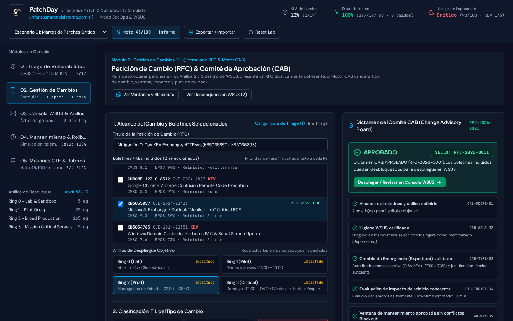
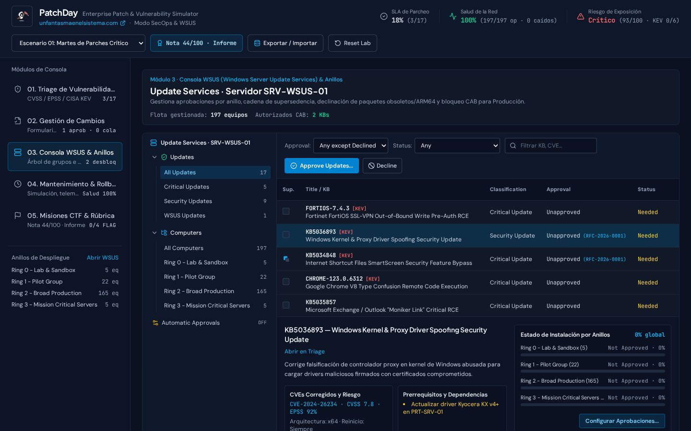
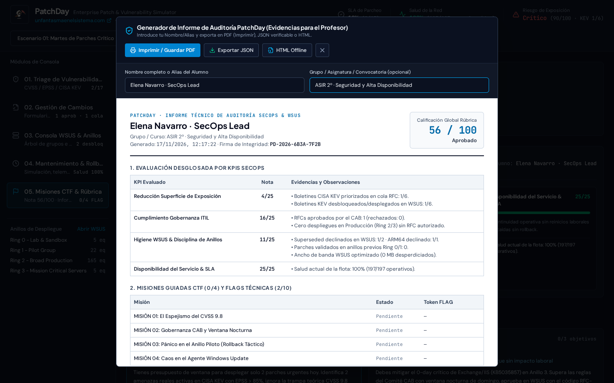

# PatchDay — Simulador Empresarial de Gestión de Parches, WSUS y SecOps

**PatchDay** es un laboratorio educativo e interactivo **100% client-side** diseñado para entrenar a analistas SecOps, administradores de sistemas (SysAdmin / ASIR) y equipos de respuesta ante incidentes en el ciclo de vida completo del parcheo corporativo: priorización de vulnerabilidades basada en riesgo real (**CVSS v3.1 + EPSS + CISA KEV**), gobernanza de cambios **ITIL (RFC / CAB)**, despliegue escalonado por anillos en consola **Microsoft WSUS (`SRV-WSUS-01`)**, diagnóstico de fallos del agente Windows Update y ejecución táctica de **rollback** en producción.

Proyecto creado para [Un Fantasma en el Sistema](https://www.unfantasmaenelsistema.com/).

---

## Características Principales

- **100% Estático y Portable (GitHub Pages Ready):** Funciona íntegramente en el navegador sin servidor ni base de datos externa. Toda la sesión se persiste automáticamente en `localStorage`, con exportación/importación en **JSON / Base64** y botón de **Reset Lab**.
- **Catálogo Realista de 17 Boletines e Inventario de 197 Equipos:** Incluye actualizaciones acumulativas de Windows 11 / Server 2022, Exchange Server, SQL Server, Fortinet FortiOS, Chrome, Apache HTTP Server, OpenSSH, xz-utils, 7-Zip y paquetes ARM64/Superseded con cadenas reales de reemplazo.
- **Arquitectura de 4 Anillos de Despliegue:**
  - **Ring 0 — Lab & Sandbox (5 equipos):** Abierto 24/7 para validación inicial y pruebas de *soak*.
  - **Ring 1 — Pilot Group (22 equipos):** Usuarios avanzados y servidores de preproducción (Martes y Jueves `14:00–16:00`).
  - **Ring 2 — Broad Production (165 equipos):** Flota corporativa general (Sábados `02:00–06:00`).
  - **Ring 3 — Mission Critical Servers (5 servidores):** Domain Controllers, clúster SQL Server y Exchange DAG (Domingos `01:00–04:00`, requiere snapshot previo).
- **Motor CAB Automático & Reglas ITIL:** Bloquea aprobaciones en Producción (Anillos 2 y 3) dentro de WSUS hasta obtener un sello válido `RFC-2026-XXXX` aprobado por el Comité de Cambios.
- **Telemetría de Errores Reales & Consola PowerShell/WinRM:** Diagnóstico sobre `WindowsUpdate.log`, Event Viewer y consola interactiva con comandos reales (`wusa /uninstall`, `DISM /RestoreHealth`, `Reset-WuAgent`, `UsoClient StartScan`, `netsh winhttp`).
- **Evaluación Automática (0–100) + Misiones CTF + Informe de Auditoría:** 4 misiones guiadas con tokens verificables `FLAG{...}`, 10 flags técnicas y generador de informe exportable en **PDF / Impresión, JSON y HTML Offline** con firma de integridad determinista.

---

## Recorrido Visual por los Módulos

### 1. Centro de Priorización de Amenazas (Triage CVSS / EPSS / CISA KEV)
Matriz visual interactiva que confronta severidad técnica (`CVSS v3.1`) frente a probabilidad real de explotación (`EPSS 30 días`) y presencia en el catálogo `CISA KEV`, desmontando trampas clásicas como priorizar un CVSS 9.8 teórico (`EPSS 2%`) por encima de un CVSS 7.8 explotado activamente (`EPSS 92% · KEV`).


---

### 2. Gestión de Cambios ITIL (Formulario RFC & Motor CAB)
Flujo de petición de cambio (`Estándar`, `Normal` o `Emergencia / Expedited`) con validación en tiempo real de pruebas previas en Ring 0/1, coherencia de reinicio, plan técnico de vuelta atrás y conflictos con ventanas de mantenimiento o *Blackout Periods* (cierre fiscal / auditoría).



---

### 3. Consola WSUS (`SRV-WSUS-01`) & Despliegue por Anillos
Réplica funcional de la consola clásica MMC de Microsoft WSUS: árbol de nodos (`Updates` y `Computers` por anillo), filtros `Approval` / `Status`, iconos visuales de supersedencia, declinación de parches obsoletos o ARM64, aprobación granular con `Deadline` y bloqueo automático si falta autorización CAB para Ring 2/3.



---

### 4. Motor de Simulación Temporal, Telemetría de Errores y Rollback en 3 Vías
Avanza el reloj simulado (`+4 Horas`, `Ventana Nocturna`, `wuauclt /reportnow`) o dispara un simulacro de regresión real para detectar bucles BSOD (`KB5036893` sin 24h de soak en Ring 0/1), caídas de Kerberos/IIS (`KB5034763` / `KB5035857`) y errores WUA (`0x800f0922`, `0x8024402c`, `0x800f081f`, `0x80070005`), remediando por:
1. **Vía 1:** `Approved for Removal` en WSUS.
2. **Vía 2:** Terminal PowerShell / WinRM (`DISM`, `wusa /uninstall`, `Reset-WuAgent`).
3. **Vía 3:** Restauración de Snapshot en Hipervisor (VMware vCenter / Proxmox).


---

### 5. Misiones CTF, Rúbrica Automática SecOps y Manual Técnico
Evaluación continua sobre **100 puntos** dividida en 4 KPIs de 25 puntos cada uno (*Reducción Superficie de Exposición*, *Cumplimiento Gobernanza ITIL*, *Higiene WSUS & Disciplina de Anillos* y *Disponibilidad del Servicio & SLA*), junto a 4 misiones guiadas CTF:

| Misión | Reto Operativo | Enfoque Técnico |
| :--- | :--- | :--- |
| **Misión 01** | *El Espejismo del CVSS 9.8* | Priorizar CISA KEV + EPSS > 85%, descartar CVSS 9.8 teórico y declinar `Superseded` |
| **Misión 02** | *Gobernanza CAB y Ventana Nocturna* | RFC de Emergencia válido para Exchange/IIS en Ring 3 sin interrumpir horario laboral |
| **Misión 03** | *Pánico en el Anillo Piloto (Rollback Táctico)* | Frenar regresión en `DEV-SQL-01` (Ring 1) antes de Ring 2 mediante `wusa` / Removal |
| **Misión 04** | *Caos en el Agente Windows Update* | Diagnosticar `0x8024402c` y `0x800f081f` en `WindowsUpdate.log` y reparar 3 servidores Ring 3 |


---

### 6. Informe Técnico de Auditoría y Manual de Referencia SecOps
Permite identificar al alumno/operador y exportar evidencias verificables en **PDF**, **JSON** o **HTML autocontenido**, además de consultar en cualquier momento la **Guía SecOps** integrada con tablas de códigos WUA, reglas CAB y comandos WinRM.




---

## Stack Tecnológico

- **Frontend:** React 19 + TypeScript
- **Estilos e Iconografía:** Tailwind CSS v4 + Lucide React
- **Build & Tooling:** Vite 8 (`base: './'` para compatibilidad directa con subrutas de GitHub Pages)
- **Persistencia:** `localStorage` del navegador + Exportación/Importación JSON/Base64

---

## Instalación y Uso Local

```bash
# 1. Clonar el repositorio
git clone https://github.com/<tu-usuario>/patchday.git
cd patchday

# 2. Instalar dependencias
npm install

# 3. Iniciar entorno de desarrollo (http://localhost:3000)
npm run dev

# 4. Verificar tipos TypeScript y generar build estático en dist/
npm run lint
npm run build
```

---

## Despliegue Automático en GitHub Pages

El repositorio incluye el flujo `.github/workflows/deploy.yml` listo para desplegar la carpeta `dist/` en **GitHub Pages** cada vez que se haga push a la rama `main`:

1. Sube el repositorio a GitHub.
2. Ve a **Settings → Pages → Build and deployment**.
3. En **Source**, selecciona **GitHub Actions**.
4. Tras ejecutarse el workflow `Deploy PatchDay to GitHub Pages`, la aplicación quedará publicada de forma estática sin requerir servidor ni variables de entorno.

---

## Estructura del Proyecto

```text
.
├── .github/workflows/deploy.yml   # Pipeline CI/CD para GitHub Pages
├── docs/screenshots/              # Capturas reales de la aplicación
├── public/assets/aistudio/        # Recursos estáticos (favicon / logo)
├── src/
│   ├── components/
│   │   ├── AuditReportModal.tsx   # Informe imprimible PDF / JSON / HTML Offline
│   │   ├── MaintenanceModule.tsx  # Calendario de ventanas y Blackout Periods
│   │   ├── PreparedModules.tsx    # Misiones CTF, Flags y Rúbrica 0–100
│   │   ├── RfcCabModule.tsx       # Formulario RFC ITIL y Motor CAB
│   │   ├── SecOpsFieldGuideModal.tsx # Manual de referencia integrado
│   │   ├── Sidebar.tsx            # Navegación de módulos y resumen de anillos
│   │   ├── SimulationTelemetryModule.tsx # Reloj, Event Viewer, WUA y WinRM
│   │   ├── StateTransferModal.tsx # Exportar / Importar JSON/Base64 y Reset
│   │   ├── TopBar.tsx             # Telemetría global SLA / Salud / Riesgo
│   │   ├── TriageModule.tsx       # Matriz CVSS vs EPSS y tabla de boletines
│   │   └── WsusConsoleModule.tsx  # Consola MMC WSUS y modal de aprobación
│   ├── data/initialData.ts        # 17 boletines, 4 anillos, flota e incidentes
│   ├── types/patchday.ts          # Tipos TypeScript del simulador
│   ├── utils/
│   │   ├── cabEngine.ts           # Reglas deterministas de auditoría ITIL CAB
│   │   ├── labStorage.ts          # Persistencia localStorage, métricas y flags
│   │   ├── rubricScoring.ts       # Cálculo de rúbrica 0–100 y misiones CTF
│   │   └── simulationEngine.ts    # Avance temporal, regresiones y WinRM CLI
│   ├── App.tsx
│   ├── index.css                  # Tema oscuro SecOps y estilos @media print
│   └── main.tsx
├── index.html
├── LICENSE                        # Licencia Apache-2.0
├── package.json
└── vite.config.ts
```

---

## Licencia

Distribuido bajo licencia **Apache License 2.0**. Consulta el archivo [`LICENSE`](./LICENSE) para más detalles.
